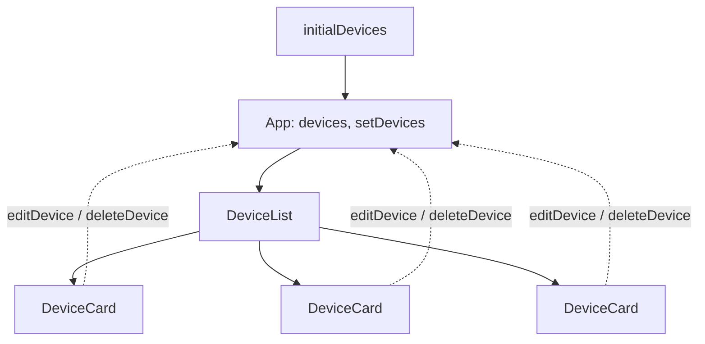

# Devices Control — управление устройствами

Учебный проект группы **FS-66**. React, JavaScript, JSX, Vite.

Репозиторий: [FullStack66-webinars/devices-control](https://github.com/FullStack66-webinars/devices-control)

## 1. Зачем мы создаём этот проект

Мы разрабатываем небольшое приложение для управления устройствами пользователя. Представьте личный кабинет сервиса, в котором зарегистрированы телефон, планшет, домашний компьютер и рабочий ноутбук. Пользователь должен видеть свои устройства, добавлять новые, изменять их данные и удалять ненужные записи.

Наша цель — не просто получить работающий интерфейс, а понять, как устроено React-приложение: где находятся данные, кто отвечает за их изменение, почему интерфейс обновляется автоматически и как отдельные компоненты взаимодействуют друг с другом.

Мы развиваем один проект постепенно. На каждом этапе добавляем функциональность, изучаем необходимые инструменты и фиксируем изменения в Git. В результате у нас будет не набор несвязанных упражнений, а приложение с понятной историей разработки.

## 2. На каком этапе мы находимся

Этот документ описывает состояние ветки `main` на 26 ноября 2026 года, зафиксированное коммитом [`7bcc424`](https://github.com/FullStack66-webinars/devices-control/commit/7bcc4249e3e65dc6ea0d50d8b42289fb6af440fe).

### Уже реализовано

- Отображение списка из пяти первоначальных устройств.
- Отдельная карточка для каждого устройства с названием и платформой.
- Автоматический подсчёт количества устройств.
- Редактирование названия прямо в карточке.
- Сохранение нового названия клавишей Enter или при потере фокуса.
- Отмена редактирования клавишей Escape.
- Отклонение пустого названия и удаление пробелов по его краям при сохранении.
- Удаление устройства.
- Сообщение `No devices found.` при пустом списке.

### Пока не реализовано в основной ветке

- Регистрация нового устройства через форму.
- Изменение платформы существующего устройства.
- Активация и деактивация устройств.
- Проверка уникальности названий и отображение сообщений валидации.
- Расширенная статистика, поиск и фильтрация.
- Постоянное хранение данных, серверные запросы и авторизация.

На данном этапе мы управляем только записями об устройствах, а не реальными телефонами или компьютерами. Приложение не выполняет удалённое управление техникой и не определяет её фактический сетевой статус.

## 3. Технологии

| Инструмент | Для чего используем |
| --- | --- |
| JavaScript | Логика приложения, обработка данных и событий |
| React | Компоненты, состояние и обновление интерфейса |
| JSX | Описание интерфейса внутри JavaScript-компонентов |
| Vite | Сервер разработки и сборка проекта |
| CSS | Внешний вид и расположение элементов |
| npm | Установка зависимостей и запуск команд |
| ESLint | Статическая проверка исходного кода |
| Git и GitHub | История изменений, ветки, pull requests и совместная работа |

Пока используем обычный JavaScript и файлы `.jsx`. TypeScript в текущую реализацию не входит. Наличие пакетов `@types/react` и `@types/react-dom` среди зависимостей для разработки само по себе не означает, что проект написан на TypeScript.

## 4. Как запустить проект

Понадобятся Git, Node.js и npm. Используйте поддерживаемую версию Node.js, совместимую с зависимостями проекта. Проверить установленные версии можно в терминале:

```bash
node --version
npm --version
git --version
```

Если проекта ещё нет на компьютере:

```bash
git clone https://github.com/FullStack66-webinars/devices-control.git
cd devices-control
npm install
npm run dev
```

Откройте адрес, который Vite выведет в терминале. Обычно это `http://localhost:5173`, но если порт занят, адрес может отличаться.

Если репозиторий уже клонирован, сначала убедитесь, что локальные изменения сохранены:

```bash
git status
git switch main
git pull --ff-only origin main
npm install
npm run dev
```

Не удаляйте незакоммиченные изменения ради обновления ветки. Если `git status` показывает Вашу незавершённую работу или `git pull --ff-only` сообщает о расхождении истории, сначала разберитесь с состоянием репозитория.

Дополнительные команды из `package.json`:

| Команда | Назначение |
| --- | --- |
| `npm run dev` | Запустить сервер разработки |
| `npm run build` | Собрать приложение для публикации |
| `npm run preview` | Локально просмотреть уже собранное приложение |
| `npm run lint` | Проверить исходный код с помощью ESLint |

`npm run lint` не заменяет проверку поведения приложения в браузере. Для остановки сервера разработки нажмите Ctrl+C в терминале.

## 5. Структура проекта

```text
devices-control/
├── src/
│   ├── components/
│   │   ├── DeviceCard.jsx
│   │   └── DeviceList.jsx
│   ├── data/
│   │   └── devices.js
│   ├── App.jsx
│   ├── App.css
│   ├── index.css
│   └── main.jsx
├── .gitignore
├── README.md
├── eslint.config.js
├── index.html
├── package.json
├── package-lock.json
└── vite.config.js
```

### Назначение файлов

| Файл | Ответственность |
| --- | --- |
| `index.html` | HTML-страница, содержащая контейнер для React |
| `src/main.jsx` | Точка входа: создание корня React и отображение `App` |
| `src/App.jsx` | Основной компонент, состояние списка и операции над устройствами |
| `src/data/devices.js` | Начальный массив устройств |
| `src/components/DeviceList.jsx` | Формирование списка карточек, обработка пустого списка |
| `src/components/DeviceCard.jsx` | Отображение устройства, локальное редактирование, кнопка удаления |
| `src/App.css` | Стили страницы, карточек, кнопок и поля редактирования |
| `src/index.css` | Общие стили приложения |
| `package.json` | Зависимости и команды npm |
| `package-lock.json` | Зафиксированные версии дерева зависимостей |
| `vite.config.js` | Конфигурация Vite и React-плагина |
| `eslint.config.js` | Правила статической проверки JavaScript и React |
| `.gitignore` | Файлы и папки, которые не должны попадать в Git |

Не стоит помещать весь код в `App.jsx`. Мы разделяем приложение на компоненты, чтобы у каждого из них была понятная ответственность.

## 6. Модель данных устройства

В файле [`src/data/devices.js`](https://github.com/FullStack66-webinars/devices-control/blob/7bcc4249e3e65dc6ea0d50d8b42289fb6af440fe/src/data/devices.js) находится исходный массив:

```javascript
export const initialDevices = [
    { id: 101, name: "Phone", platform: "Android" },
    { id: 102, name: "iPhone", platform: "iOS" },
    { id: 103, name: "Work laptop", platform: "Linux" },
    { id: 104, name: "iPad", platform: "iOS" },
    { id: 105, name: "Comp", platform: "Windows" }
];
```

Каждое устройство — объект с тремя свойствами:

- `id` — уникальный идентификатор записи;
- `name` — название, которое видит пользователь;
- `platform` — операционная система устройства.

Почему мы используем `id`, а не название или индекс массива? Название может измениться, а позиция устройства в массиве может измениться после удаления или сортировки. Идентификатор должен оставаться стабильным на протяжении жизни записи.

В текущей версии ID — числа. При добавлении новых устройств нам предстоит выбрать согласованный способ генерации идентификаторов. Если мы используем `crypto.randomUUID()`, разумно привести и первоначальные ID к строковому типу, чтобы не смешивать два формата. UUID создаётся один раз при добавлении записи, а не при каждом рендере.

## 7. Как запускается React

В `index.html` предусмотрен корневой HTML-элемент. В `src/main.jsx` мы создаём корень React:

```jsx
import { StrictMode } from 'react'
import { createRoot } from 'react-dom/client'
import './index.css'
import App from './App.jsx'

createRoot(document.getElementById('root')).render(
  <StrictMode>
    <App />
  </StrictMode>,
)
```

`document.getElementById('root')` находит DOM-элемент, внутрь которого React будет отображать приложение. `createRoot()` создаёт корень React, а `render()` передаёт ему дерево компонентов.

`App` написан с большой буквы, потому что JSX различает пользовательские компоненты и встроенные HTML-элементы: `<App />` означает React-компонент, а `<main>` — HTML-элемент.

`StrictMode` включает дополнительные проверки в режиме разработки. Он помогает выявлять некоторые ошибки, связанные с нечистыми вычислениями и побочными эффектами. Его наличие не означает, что приложение обязательно выполняет каждое действие пользователя дважды.

## 8. Где хранится список устройств

В [`App.jsx`](https://github.com/FullStack66-webinars/devices-control/blob/7bcc4249e3e65dc6ea0d50d8b42289fb6af440fe/src/App.jsx) используется хук `useState`:

```jsx
const [devices, setDevices] = useState(initialDevices);
```

`devices` — состояние списка для текущего рендера. `setDevices` — функция, с помощью которой мы запрашиваем обновление этого состояния. `initialDevices` используется как начальное значение.

Мы уже разбирали, зачем React нужен специальный механизм состояния. Обычная локальная переменная внутри функции компонента не обеспечивает сохранение значения между рендерами и не сообщает React о необходимости обновить интерфейс.

Например, если бы мы просто изменили свойство объекта внутри массива, React мог бы не получить необходимого сигнала об изменении состояния. Поэтому мы создаём новый массив и передаём его через `setDevices`.

Важно: вызов функции обновления состояния не изменяет переменную `devices` мгновенно внутри уже выполняющегося обработчика. React планирует обновление, после которого компонент получает новое значение состояния при следующем рендере.

## 9. Как компоненты взаимодействуют друг с другом



`App` хранит список и функции, которые меняют этот список. `DeviceList` получает данные и функции через props. Затем он передаёт отдельные объекты и обработчики каждому `DeviceCard`.

В `App.jsx`:

```jsx
<DeviceList
    devices={devices}
    deleteDevice={deleteDevice}
    editDevice={editDevice}
/>
```

Компонент `DeviceList` принимает эти props:

```jsx
export default function DeviceList({ devices, deleteDevice, editDevice }) {
    // ...
}
```

Фигурные скобки в параметрах функции здесь означают деструктуризацию объекта props. Мы используем уже известный механизм JavaScript.

В React данные передаются от родителя к дочернему компоненту. Для изменения родительского состояния дочерний компонент вызывает переданную ему функцию. Он не получает права напрямую изменять состояние родителя.

## 10. Как формируется список карточек

В [`DeviceList.jsx`](https://github.com/FullStack66-webinars/devices-control/blob/7bcc4249e3e65dc6ea0d50d8b42289fb6af440fe/src/components/DeviceList.jsx) применяется знакомый метод массива `map()`:

```jsx
{devices.map((device) => (
    <DeviceCard
        key={device.id}
        device={device}
        deleteDevice={deleteDevice}
        editDevice={editDevice}
    />
))}
```

Для каждого объекта создаётся описание отдельного React-компонента. Если в массиве пять объектов, мы увидим пять карточек.

`key` помогает React сопоставлять элементы списка между рендерами. При удалении или перестановке устройства React сможет определить, какая карточка относится к какой записи. Это особенно важно, поскольку каждая карточка имеет собственное локальное состояние редактирования. Индекс массива здесь был бы ненадёжным ключом.

`key` — специальное свойство React, а не обычный prop, доступный внутри `DeviceCard`. Сам идентификатор доступен через `device.id`.

При пустом массиве компонент возвращает другое описание интерфейса:

```jsx
if (devices.length === 0) {
    return <p className="muted">No devices found.</p>;
}
```

Это пример условного рендеринга: отображаемый интерфейс зависит от текущих данных.

## 11. Как работает удаление

В `DeviceCard.jsx` кнопка вызывает переданную функцию:

```jsx
<button
    className='danger'
    onClick={() => deleteDevice(device.id)}
>
    Delete
</button>
```

Почему здесь стрелочная функция? Мы хотим вызвать `deleteDevice` только после нажатия кнопки, а не во время рендера карточки. Запись `onClick={deleteDevice(device.id)}` вызвала бы функцию сразу при вычислении JSX.

Сама операция выполняется в `App.jsx`:

```jsx
function deleteDevice(id) {
    setDevices(prev => prev.filter(device => device.id !== id));
}
```

`filter()` создаёт новый массив, в который входят все устройства, кроме записи с переданным ID. Исходный массив не изменяется.

Например, при удалении ID `102`:

```text
До:     [101, 102, 103, 104, 105]
После:  [101,      103, 104, 105]
```

Функциональная форма `setDevices(prev => ...)` получает предыдущее состояние, актуальное для данного обновления. Это полезно, когда новое состояние зависит от старого.

После обновления списка React снова вычисляет интерфейс. Удалённая карточка исчезает, а счётчик уменьшается автоматически.

## 12. Как устроено редактирование названия

В [`DeviceCard.jsx`](https://github.com/FullStack66-webinars/devices-control/blob/7bcc4249e3e65dc6ea0d50d8b42289fb6af440fe/src/components/DeviceCard.jsx) есть два локальных состояния:

```jsx
const [isEditing, setIsEditing] = useState(false);
const [draftName, setDraftName] = useState(device.name);
```

- `isEditing` отвечает за режим карточки: просмотр или редактирование.
- `draftName` хранит черновик названия, которое пользователь вводит в поле.

Зачем нужен черновик? Пока пользователь вводит текст, мы ещё не обязаны менять сохранённые данные. Возможность отменить редактирование предполагает, что исходное и редактируемое значения могут временно различаться.

Кнопка Edit переключает режим:

```jsx
<button disabled={isEditing} onClick={() => setIsEditing(true)}>
    Edit
</button>
```

В режиме просмотра показывается заголовок, а в режиме редактирования — поле ввода. Ниже приведён фрагмент текущего JSX с изменённым форматированием для удобства чтения:

```jsx
{isEditing ? (
    <input
        className='name-input'
        type="text"
        value={draftName}
        autoFocus
        onBlur={handleSaveClick}
        onKeyDown={(e) => {
            if (e.key === 'Enter') handleSaveClick()
            if (e.key === 'Escape') handleCancelClick()
        }}
        onChange={(e) => setDraftName(e.target.value)}
    />
) : <h2>{device.name}</h2>}
```

Здесь уже используется **управляемое поле ввода (controlled input)**. Свойство `value` связано с React-состоянием, а `onChange` обновляет это состояние при вводе текста.

Последовательность действий:

1. Пользователь нажимает Edit.
2. Вместо заголовка появляется поле с текущим черновиком названия.
3. При изменении текста `onChange` вызывает `setDraftName`.
4. При Enter или потере фокуса вызывается сохранение.
5. При Escape вызывается отмена.

Это важная отправная точка следующего этапа: нам не нужно знакомиться с управляемыми полями с нуля. Мы уже имеем одно такое поле и расширим этот механизм до полноценной формы.

### Сохранение

```jsx
function handleSaveClick() {
    const newName = draftName.trim()
    if (newName === "") {
        handleCancelClick()
        return;
    }
    editDevice(device.id, newName);
    setDraftName(newName);
    setIsEditing(false);
}
```

`trim()` удаляет пробелы по краям строки. Если после этого название пустое, изменение отменяется. Иначе карточка вызывает `editDevice`, передавая идентификатор и новое название. Затем черновик обновляется и режим редактирования закрывается.

### Отмена

```jsx
function handleCancelClick() {
    setDraftName(device.name);
    setIsEditing(false);
}
```

При отмене мы восстанавливаем исходное название и выходим из режима редактирования. Родительский список при этом не меняется.

### Обновление родительского состояния

В `App.jsx`:

```jsx
function editDevice(id, newName) {
    setDevices(prev => prev.map(device => (
        device.id === id ? {...device, name: newName} : device
    )));
}
```

`map()` создаёт новый массив. Для нужного устройства создаётся новый объект с помощью spread-оператора. Все остальные свойства сохраняются, а `name` получает новое значение. Для остальных устройств возвращаются исходные объекты.

```javascript
{ ...device, name: newName }
```

Порядок свойств здесь имеет значение: новое название располагается после `...device`, поэтому оно заменяет старое.

Мы не пишем `device.name = newName` и не изменяем исходный массив напрямую. Такой подход называется иммутабельным обновлением состояния.

## 13. Почему не нужен отдельный state для счётчика

В `App.jsx` количество устройств вычисляется непосредственно из массива:

```jsx
<p className="summary"> Number of devices: {devices.length}</p>
```

Нет необходимости заводить отдельное состояние `count`, а затем синхронизировать его при каждом добавлении и удалении устройства.

Количество устройств — производное значение (derived value). Оно полностью определяется текущим списком. Если список изменится, при следующем рендере будет вычислено новое значение `devices.length`.

Этот же принцип мы применим при создании статистики, поиска и фильтрации.

## 14. История нашей разработки

История коммитов помогает понять, как проект менялся. Ниже приведены реальные коммиты, входящие в историю указанной версии `main`.

| Коммит | Сообщение | Что отражает |
| --- | --- | --- |
| [`9726cb1`](https://github.com/FullStack66-webinars/devices-control/commit/9726cb1507f755f06d520c815017e4831de71d0f) | `early solution for control panel` | Первоначальная версия панели управления |
| [`ed530ed`](https://github.com/FullStack66-webinars/devices-control/commit/ed530edb358faef07217a46486e16af3684b9314) | `change README` | Изменение документации |
| [`f678bb5`](https://github.com/FullStack66-webinars/devices-control/commit/f678bb574b0825a5e9741776b52286b2294407ae) | `Merge pull request #1` | Включение изменений документации в main |
| [`2825530`](https://github.com/FullStack66-webinars/devices-control/commit/2825530d6bc3d1c8a1ccb8540ed9148fccf684af) | `Add edit and delete buttons to device cards` | Добавление операций редактирования и удаления |
| [`e595573`](https://github.com/FullStack66-webinars/devices-control/commit/e595573fdb53b6b1d09ed4151cc5ecec4493cb60) | `Fix typo in devices counter` | Исправление текста счётчика |
| [`b4f0532`](https://github.com/FullStack66-webinars/devices-control/commit/b4f0532d3d4cbdd26fc1adae1ce45ff372b61c1e) | `Add cancel editing with Escape key` | Отмена редактирования с клавиатуры |
| [`8d0a9b3`](https://github.com/FullStack66-webinars/devices-control/commit/8d0a9b34a669b925cffff8dce0db15f405983905) | `Correct name` | Исправление, отражённое в сообщении коммита |
| [`2054f6e`](https://github.com/FullStack66-webinars/devices-control/commit/2054f6e9a5f80ac75aa935e130ff1566c141dabe) | `Disable Edit button while editing` | Блокировка повторного запуска редактирования |
| [`7bcc424`](https://github.com/FullStack66-webinars/devices-control/commit/7bcc4249e3e65dc6ea0d50d8b42289fb6af440fe) | `Merge pull request #2` | Включение решения редактирования и удаления в main |

Откройте коммиты на GitHub и изучите вкладку с изменениями файлов. Обратите внимание, что отдельный коммит может решать небольшую конкретную задачу. Не обязательно ждать завершения всего проекта, чтобы сохранить промежуточный результат.

### Разные решения одной задачи

В ходе совместной работы были предложены три подхода:

| Pull request | Идея | Статус на момент подготовки документа |
| --- | --- | --- |
| [#2 — Add edit and delete buttons to device cards](https://github.com/FullStack66-webinars/devices-control/pull/2) | Inline-редактирование названия в карточке | Объединён с `main` |
| [#3 — feat: add device rename modal](https://github.com/FullStack66-webinars/devices-control/pull/3) | Модальное окно, выделение логики в собственные хуки | Открыт, не объединён |
| [#4 — Add device editing and deletion functionality](https://github.com/FullStack66-webinars/devices-control/pull/4) | Редактирование через выпадающий список с изменением платформы | Открыт, не объединён |

Описание двух открытых решений основано на их pull request descriptions. Их изменения не являются частью текущей основной ветки.

Разные подходы к одной задаче — нормальная ситуация в разработке. Мы не обязаны объединять все реализации. Важно научиться сравнивать решения, объяснять их достоинства и ограничения, обсуждать код и выбирать вариант, подходящий проекту.

## 15. Проверяем текущую версию самостоятельно

Перед продолжением разработки запустите приложение и проверьте следующие сценарии. Это контрольный список ожидаемого поведения по текущему коду, а не отчёт о проведённом автоматизированном тестировании.

| Действие | Ожидаемый результат |
| --- | --- |
| Открыть приложение | Пять карточек, счётчик равен пяти |
| Нажать Edit | Название становится редактируемым, Edit блокируется |
| Изменить название и нажать Enter | Новое название сохраняется |
| Изменить название и кликнуть вне поля | Название сохраняется при потере фокуса |
| Изменить название и нажать Escape | Черновик отменяется |
| Попробовать сохранить пустую строку или пробелы | Сохраняется прежнее название |
| Ввести название с пробелами по краям и сохранить | Пробелы по краям удаляются |
| Нажать Delete | Устройство исчезает, счётчик уменьшается |
| Удалить все устройства | Счётчик равен нулю, отображается `No devices found.` |
| Перезагрузить страницу | Возвращаются исходные пять устройств |

Отдельно проверьте сочетания клавиатурных событий и потери фокуса, например Escape с последующим кликом вне поля. Если обнаружите неожиданное поведение, зафиксируйте шаги воспроизведения в Issue. Не считайте отсутствие ошибки в консоли доказательством правильности всей программы.

## 16. Ограничения текущего решения

Сейчас приложение работает только с состоянием в памяти. `useState` не является базой данных. После полной перезагрузки страницы приложение вновь инициализируется исходным массивом.

Проверка названия выполняется непосредственно в карточке и проверяет только пустую строку. Нет общего набора правил для всех операций над устройствами. Пользователь не получает отдельного сообщения об ошибке.

Кроме того, `useState(device.name)` задаёт начальный черновик при монтировании карточки, но не синхронизирует его автоматически со всеми будущими изменениями props. Пока название меняется через саму карточку, черновик обновляется обработчиками. Когда появятся другие способы изменения устройства, необходимо будет продумать инициализацию черновика при начале редактирования.

Наконец, текущая модель не содержит признака активности и не позволяет изменить платформу. Именно эти ограничения определяют наш следующий шаг.

---

# Следующий этап — Device Registration and Management

## 17. Что мы хотим получить

Мы продолжаем существующий проект, а не создаём новое приложение. Наша ближайшая задача — научиться регистрировать устройства и расширить возможности управления ими.

Сейчас список можно просматривать, удалять записи и переименовывать их. Но невозможно добавить новый телефон или ноутбук. Это значит, что нам пока не хватает полноценного набора операций CRUD:

| Операция | Значение | Текущее состояние |
| --- | --- | --- |
| Create | Создание записи | Предстоит реализовать |
| Read | Чтение и отображение | Реализовано |
| Update | Изменение | Пока только название |
| Delete | Удаление | Реализовано |

Наша цель — дополнить существующие возможности, сохранив работающие функции и структуру проекта.

## 18. Расширяем модель устройства

Предлагаемая модель следующего этапа:

```javascript
{
    id: 101,
    name: "Phone",
    platform: "Android",
    isActive: true
}
```

Новое свойство `isActive` — логический признак активности устройства внутри нашего приложения. `true` означает активное устройство, `false` — неактивное. Это не результат сетевой диагностики.

Начальным устройствам нужно задать явные значения активности. Остальные свойства пока сохраняем. Выбор окончательного формата идентификаторов согласуем при реализации добавления новых записей.

## 19. Форма регистрации нового устройства

Предлагаемая схема интерфейса (не текущий внешний вид):

```text
My devices                         [ Add device ]

Total: 5       Active: 3       Inactive: 2

Register device
  Device name      [ Home laptop          ]
  Platform         [ Windows            v ]
  Active           [x]

                   [ Save device ] [ Cancel ]

Phone                 Android       Active
                      [ Edit ] [ Delete ]
```

Для формы создадим отдельный компонент `DeviceForm.jsx`. Он будет отвечать за ввод данных, отображение ошибок и передачу проверенных данных в родительский компонент.

Планируемые поля:

| Поле | Тип элемента | Тип значения в состоянии |
| --- | --- | --- |
| Device name | `input` | string |
| Platform | `select` | string |
| Active | `input type="checkbox"` | boolean |

Допустимые платформы: Android, iOS, Windows, macOS и Linux. Предлагается хранить их в одном общем массиве констант, чтобы форма и валидация использовали одинаковый перечень.

В отличие от текущей карточки, мы будем работать сразу с несколькими полями. Это создаёт практическую необходимость изучить объект состояния формы, обработчики событий разных элементов и передачу результатов родительскому компоненту.

### Как должна работать форма

1. Пользователь нажимает Add device.
2. Открывается форма с начальными значениями.
3. Пользователь вводит название, выбирает платформу и статус.
4. При сохранении данные проходят проверку.
5. Если найдены ошибки, форма остаётся открытой и показывает понятные сообщения.
6. Если данные корректны, `App` добавляет новое устройство в состояние списка.
7. Форма очищается или закрывается, а список и статистика обновляются.
8. Cancel закрывает форму без добавления записи.

На этом этапе достаточно обычной формы на JSX и `useState`. Дополнительные библиотеки управления формами пока не требуются.

## 20. Какие правила проверки данных вводим

Для нашего учебного проекта согласуем следующие правила:

| Данные | Правило |
| --- | --- |
| Название | После удаления пробелов по краям от 2 до 50 символов |
| Платформа | Одно из разрешённых значений |
| Активность | Логическое значение `true` или `false` |
| Уникальность | Названия в одном списке не повторяются без учёта регистра и крайних пробелов |

Проверка уникальности — учебное бизнес-правило, выбранное для этого проекта, а не универсальное правило для всех систем управления устройствами.

Например, `Home laptop` и ` home LAPTOP ` должны считаться одинаковыми названиями. При редактировании проверка должна исключать саму редактируемую запись по её ID, чтобы сохранение прежнего названия не воспринималось как дубликат.

Правила должны применяться согласованно. Если мы сохраняем существующее inline-редактирование, оно тоже должно соблюдать ограничения названия и уникальности. Иначе форму добавления можно будет обойти через переименование устройства.

В будущем вынесем чистые функции проверки в отдельный модуль. Клиентская валидация улучшает удобство работы пользователя, но при появлении backend сервер обязан самостоятельно проверять входящие данные.

## 21. Активация и деактивация

После расширения модели добавим возможность изменить `isActive`. Это очередной пример обновления конкретного объекта внутри массива без прямой мутации.

У активного устройства должна быть возможность деактивации, у неактивного — активации. Изменение статуса не должно создавать новую запись или менять идентификатор устройства.

## 22. Статистика устройств

Предлагается создать отдельный компонент `DeviceStatistics.jsx`.

Он будет показывать:

- общее количество устройств;
- количество активных;
- количество неактивных.

Все три значения вычисляются из текущего массива. Хранить для них три отдельных состояния не нужно. При добавлении, удалении и изменении статуса статистика должна обновляться автоматически.

## 23. Что делать с редактированием

Существующее inline-редактирование сохраняем как отправную точку. Оно является результатом работы нашей группы.

После освоения формы регистрации расширим редактирование до изменения названия, платформы и активности. Рассмотрим два подхода: сохранить быстрое переименование непосредственно в карточке или использовать общую форму для добавления и изменения записи. Решение примем после сравнения вариантов, а не путём автоматического объединения конфликтующих pull requests.

При полноценном редактировании должны соблюдаться следующие условия:

- форма получает данные выбранного устройства;
- изменения до сохранения не затрагивают исходную запись;
- сохранение обновляет именно выбранное устройство, сохраняя его ID;
- отмена оставляет исходные данные без изменений;
- проверка уникальности не сравнивает запись саму с собой.

Это продолжение этапа Device Registration and Management. Не обязательно реализовывать все эти возможности в одном занятии.

## 24. Что мы изучаем на этом этапе

| Практическая задача | Учебная тема |
| --- | --- |
| Открытие и закрытие формы | Состояние интерфейса, условный рендеринг |
| Ввод названия | Controlled Components |
| Выбор платформы | Управляемый `select` |
| Изменение активности | `checked` и `onChange` |
| Несколько полей формы | Объекты состояния, иммутабельность |
| Отправка формы | `onSubmit`, `preventDefault()` |
| Проверка названия и платформы | Валидация, чистые функции |
| Добавление устройства | Callback props, создание нового массива |
| Изменение статуса | Обновление объекта через `map()` |
| Расширение статистики | Производные значения, композиция компонентов |
| Сравнение способов редактирования | Разделение ответственности, локальное состояние |

Мы будем опираться на уже изученные JavaScript, массивы, объекты, события, props и `useState`. Важно не просто повторить синтаксис, а научиться применять его в более сложном интерфейсе.

## 25. Как будем развивать проект дальше

После завершения регистрации и управления устройствами последовательно добавим новые возможности. Это предварительная дорожная карта, а не описание уже реализованной функциональности и не обязательство изучить все темы на ближайшем занятии.

| Этап | Практический результат | Учебные темы |
| --- | --- | --- |
| Device Registration and Management | Добавление, валидация, изменение статуса, статистика, расширение редактирования | Forms, Events, State |
| Search and Filtering | Поиск, фильтры по платформе и активности, сортировка | Derived State, Lift State Up |
| Data Persistence | Сохранение и восстановление списка в браузере | `localStorage`, `useEffect`, зависимости эффекта |
| State Logic | Выделение повторно используемой логики | Custom Hooks, `useReducer`, другие хуки по необходимости |
| API Integration | Получение и изменение данных через API | Асинхронность, HTTP, loading/error state, TanStack Query |
| SPA Navigation | Страницы устройств, деталей и настроек | React Router, SPA |
| UI Components | Развитие интерфейса на основе готовых компонентов | UI Library |
| Shared State | Общие настройки и состояние пользователя | Context API, Redux Toolkit |
| Testing | Проверка логики и пользовательских сценариев | Тестирование React |

Порядок поздних этапов может измениться в зависимости от учебной программы. В частности, переход на TypeScript будет отдельным согласованным этапом. Нынешняя реализация остаётся на JavaScript, а модель данных и разделение компонентов позволят в дальнейшем провести миграцию без смены предметной области.

В перспективе проект можно будет дополнить собственным Node.js/Express API, базой данных и авторизацией. Сейчас это направление развития, а не готовая функциональность.

## 26. Как работаем вместе через GitHub

Перед новой задачей убедитесь, что Вы работаете с актуальной версией основной ветки. Для каждой самостоятельной задачи создавайте отдельную ветку. Например:

```bash
git status
git switch main
git pull --ff-only origin main
git switch -c feature/device-registration
```

Имя ветки — пример. При совместной работе согласуйте уникальное название, чтобы не пересекаться с ветками одногруппников.

После завершения небольшого логического изменения:

```bash
git status
git diff
git add src/components/DeviceForm.jsx
git commit -m "feat: add device registration form"
git push -u origin feature/device-registration
```

Этот пример предполагает, что указанный файл уже создан. Если Вы изменили другие файлы, проверьте их и добавьте к коммиту необходимые изменения. Не добавляйте в репозиторий `node_modules`, секреты и локальные настройки среды.

Затем откройте Pull Request в `main`. В описании укажите, какую задачу решали, что изменили, как проверить результат и какие ограничения остались.

Не объединяйте PR самостоятельно без согласованного code review. Если возник конфликт слияния, не удаляйте чужие изменения автоматически: разберитесь, почему обе ветки изменили один и тот же участок кода.

### Предлагаемые будущие коммиты

Ниже не история Git, а ориентиры для нашей дальнейшей работы:

```text
docs: document current project state
feat: extend device data model
feat: add device registration form
feat: implement controlled form fields
feat: implement device creation
feat: validate device input
feat: add device activation controls
feat: display device statistics
```

Каждый коммит должен отражать реально выполненное изменение. В зависимости от последовательности разработки отдельные шаги могут быть объединены или разделены.

## 27. Что полезно вспомнить перед продолжением

Попробуйте самостоятельно ответить на вопросы по существующему коду:

1. Почему список устройств хранится в `App`, а не отдельно в каждой карточке?
2. Чем props отличаются от state?
3. Для чего нужны `isEditing` и `draftName`?
4. Что произойдёт, если удалить `onChange` у управляемого поля ввода?
5. Почему удаление использует `filter()`, а редактирование — `map()`?
6. Зачем мы создаём новый объект через spread?
7. Почему `key` должен оставаться стабильным?
8. Почему счётчик не хранится в отдельном `useState`?
9. Почему после перезагрузки браузера возвращаются исходные устройства?
10. Какие изменения потребуется внести, чтобы добавить новое устройство, не создавая дубликатов ID?

Не обязательно знать ответы наизусть. Откройте исходные файлы и проследите путь данных от действия пользователя до обновления интерфейса.

## 28. Критерии завершения ближайшего этапа

- [ ] Пользователь может открыть форму регистрации и закрыть её без сохранения.
- [ ] Название, платформа и активность управляются состоянием React.
- [ ] Некорректные данные не приводят к добавлению записи.
- [ ] Ошибки отображаются понятным пользователю способом.
- [ ] Новое устройство получает стабильный уникальный ID.
- [ ] Корректная запись появляется в списке без перезагрузки страницы.
- [ ] Активность устройства можно изменить.
- [ ] Статистика вычисляется из актуального списка.
- [ ] Ранее реализованные переименование и удаление продолжают работать.
- [ ] Изменения оформлены понятными коммитами и проверены в браузере.

Расширенное редактирование всех полей — следующий шаг внутри этого же этапа, после завершения основной формы и проверки базовых сценариев.

---

**Главная идея проекта:** каждая новая возможность должна решать понятную практическую задачу, а каждая новая технология — появляться тогда, когда мы понимаем, зачем она нам нужна. Продолжаем развивать Devices Control на основе нашей собственной работы и сохраняем историю этого развития в GitHub.
